# Memory Graph V1

The current V1 graph is an insight graph, not a raw photo index. The engine turns local measurements into grounded claims, and a narrator composes reflections from selected claims.

```mermaid
flowchart LR
    A["55,771 canonical photos"] --> B["Local ingest\nHDD + Photos derivatives"]
    B --> C["Persisted photo records\nEXIF • camera • light • geometry • scenes"]
    C --> D["Technical signals\noptics • aperture • shutter • ISO • EV\nhorizon • negative space • sharpness"]
    C --> E["Human signals\nfaces • named people • anonymous recurrence\n52,114 face observations / 871 clusters"]
    C --> F["Content/context\nscene labels • camera families • lens\nGPS coverage • eras • seasons"]
    D --> G["5-quadrant soft vector"]
    E --> H["Resonance ranking\nQ weights + faces + favorites + taste"]
    F --> H
    G --> H
    H --> I["Daily dispatch\n1–3 local memories"]
    D --> J["Insight graph\n192 grounded nodes / 33 dimensions"]
    E --> J
    F --> J
    H --> J
    J --> K["ask / critique / style-over-time"]
    K --> L["Apple Foundation Models\nor local Claude CLI"]
    L --> M["Narrated reflection\ntext only; pixels stay local"]

    subgraph Families["Promoted insight families"]
      N1["Emotional style / era style"]
      N2["Framing / depth / exposure / geometry"]
      N3["Camera / lens / season / travel"]
      N4["People / relationships / anonymous recurrence"]
      N5["Subjects / landscapes / light / color"]
      N6["Change / trends / resonance gap / taste"]
    end
    J -.-> Families
```

The graph is intentionally bounded. More photos deepen evidence; new insight families add new dimensions. V2 adds personal tuning rather than silently changing historical claims.
